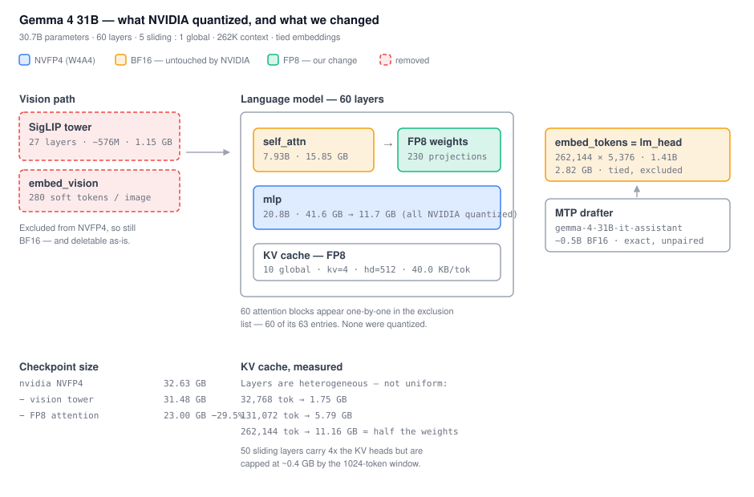

# Gemma 4 31B — NVFP4 + FP8 attention + text-only + paired drafter

What this does to [`nvidia/Gemma-4-31B-IT-NVFP4`](https://huggingface.co/nvidia/Gemma-4-31B-IT-NVFP4),
and why each part is defensible.



## What NVIDIA actually shipped

NVFP4 is a 4-bit weight **and** activation format, but the build's `hf_quant_config.json`
excludes 63 modules, and 60 of them are the attention blocks — listed one layer at a time.

| Component | Params | State | Size |
|---|---|---|---|
| MLPs (60 layers) | 20.8B | NVFP4, group 16 | 41.6 → ~11.7 GB |
| Attention (60 layers) | 7.93B | **untouched, BF16** | 15.85 GB |
| Embeddings (tied = `lm_head`) | 1.41B | untouched | 2.82 GB |
| Vision tower (SigLIP, 27 layers) | ~576M | untouched | ~1.15 GB |

That sums to ~31.5 GB against the repo's actual 32.67 GB, so the accounting holds. Only
the MLPs were quantized, which leaves **unquantized attention as the largest single block
in the file** — bigger than all the NVFP4 weights combined.

Verify it yourself rather than taking the table on trust:

```bash
unfuse inspect ~/models/gemma-4-31b-nvfp4 --quant --depth 3
```

## The three changes

### 1. Remove the vision tower

Gemma 4 31B is `model_type: gemma4` with a real SigLIP tower — unlike Gemma 4 **12B**,
which is `gemma4_unified` and encoder-free, where the entire vision path is a 52M input
embedder and removing it saves nothing. Always check `model_type` first.

Pure tensor deletion, no arithmetic on any surviving weight. The wrinkle specific to a
quantized checkpoint: deleting the vision modules leaves entries in `exclude_modules`
pointing at tensors that no longer exist, and those have to be pruned too.

### 2. FP8 attention — weights only

The obvious win, and the one NVIDIA left on the table: 15.85 GB → 7.93 GB, about a quarter
off the whole checkpoint.

Weights-only is a deliberate choice. FP8 has two independent halves with very different
risk profiles:

- **Weights** are a pure function of the weights. No calibration set, no forward passes,
  nothing to get wrong beyond the scale arithmetic.
- **Activations** need calibration, and attention activations are the outlier-heavy ones
  that SmoothQuant and AWQ exist to handle. That is where the accuracy risk lives.

Weights-only still takes the full memory win and still speeds up batch-1 decode, which is
memory-bandwidth-bound rather than compute-bound. What it gives up is a prefill speedup —
BF16 activations cannot feed FP8 tensor cores. `--activations` takes the other side of
that trade when there is a reason to.

This is not an exotic layout. NVIDIA's own DeepSeek-V4 and Qwen3-Omni builds ship FP4
experts alongside FP8 attention, and vLLM reads per-layer algorithms from
`quantization_config.quantized_layers`. Leaving attention at BF16 is the deviation.

```bash
python tools/fp8_attention.py ~/models/gemma-4-31b-nvfp4-text ~/models/gemma-4-31b-final
```

### 3. Pair the MTP drafter

[`google/gemma-4-31B-it-assistant`](https://huggingface.co/google/gemma-4-31B-it-assistant)
is a ~0.5B BF16 drafter for this exact target, claiming up to 3×. No NVFP4-paired build
exists.

Speculative decoding is **exact by construction** — the target verifies every drafted
token and discards what it would not have produced — so this costs no accuracy at all. It
only changes throughput, and throughput depends entirely on acceptance rate.

Which is the open question, and the most interesting thing here. The drafter was trained
against the **BF16** target. Quantizing the target moves its distribution, so the drafter
is now predicting a slightly different model than the one it learned. Nobody has published
what that costs on an NVFP4 target. `tools/bench_spec_decode.py` measures it as **tokens
per target forward pass** — the arithmetic ceiling on speedup, independent of hardware,
where wall-clock would confound acceptance with kernel efficiency.

## How this is verified

Extraction gets `unfuse verify`, which demands **identical bits**. Quantization cannot
meet that bar — rounding every weight is the entire operation — so it gets `unfuse
agreement` instead, and the two deliberately share no code.

The problem with any absolute threshold is that nobody can justify the number. Is a KL of
0.004 acceptable? There is no principled answer, and the moment a threshold exists someone
tunes it until their checkpoint passes.

So the bar is comparative. NVIDIA shipped a quantized build and published its benchmark
scores, which means they have already decided how much damage is acceptable. Score their
checkpoint against BF16 and score ours the same way:

```bash
unfuse agreement google/gemma-4-31B-it ~/models/gemma-4-31b-final \
    --baseline nvidia/Gemma-4-31B-IT-NVFP4
```

A strict "no worse than the baseline" gate is the right test only when a change is not
supposed to cost anything. **This change adds quantization on top of NVIDIA's**, so it
cannot pass that gate by construction, and reporting it as a pass/fail would be a rigged
test. What matters is the *increment*: `marginal_cost` reports our divergence as a
multiple of the divergence NVIDIA already shipped. Adding 8% to an error someone already
judged acceptable is a very different claim from adding 300%, and neither is visible in an
absolute KL.

Both halves are reported, because a model can shave average divergence while flipping more
greedy choices, and greedy choices are what a user experiences.

Verification runs by **expanding** each checkpoint back to BF16 (`tools/dequantize.py`).
That is not an approximation: weight-only quantization is exactly simulatable, since an
FP4 or FP8 kernel dequantizes the stored weight before multiplying against BF16
activations anyway. What it does not simulate is NVFP4's *activation* quantization, so
both sides are very slightly optimistic — equally, which keeps the comparison fair for the
weight change under test.

Expansion is also a practical necessity: transformers has no loader for `quant_method:
modelopt`. It ignores the quantization config entirely, loads the packed `uint8` tensors as
dense weights, and dies on a shape mismatch of exactly 2× the input dimension — which is
itself the tell that NVFP4 packs two 4-bit values per byte.

## The KV cache, measured properly

Gemma 4 runs 5 sliding-attention layers to 1 global, so only 10 of 60 layers hold a
full-length KV cache. The window is 262,144 tokens and NVIDIA already set the cache to
FP8 — but the layers are **heterogeneous**, and that changes the answer:

```
 10 x full_attention     kv_heads=4   head_dim=512   -> 40.0 KB/token
 50 x sliding_attention  kv_heads=16  head_dim=256   -> capped at ~0.4 GB

   32,768 tokens ->   1.75 GB
  131,072 tokens ->   5.79 GB
  262,144 tokens ->  11.16 GB
```

The counter-intuitive part: the **sliding** layers carry four times the KV heads of the
global ones, but the 1024-token window caps their cache at a fixed ~0.4 GB however long the
context runs. Only the 10 global layers grow.

At the full 262k window that is roughly 11 GB — about half the quantized weights. Assuming
uniform layers (transformers refuses a global read of `num_key_value_heads` precisely
because they are not) doubles that figure and produces the much stronger claim that the
cache matches the weights. It does not. The cache is worth knowing about; it does not
outrank the weight savings.

## Hardware

Steps 1 and 2 are pure tensor transforms and need **no GPU** — weights-only FP8 means
there is no calibration pass. Scoring needs one.

NVFP4 executes only on **Blackwell**; Hopper has no FP4 tensor cores, so timings taken on
an H100 reflect a fallback path and are labelled as such. Acceptance rate (`tok/fwd`) is
still meaningful there, since it is a property of the two models' distributions rather
than of the kernels.
